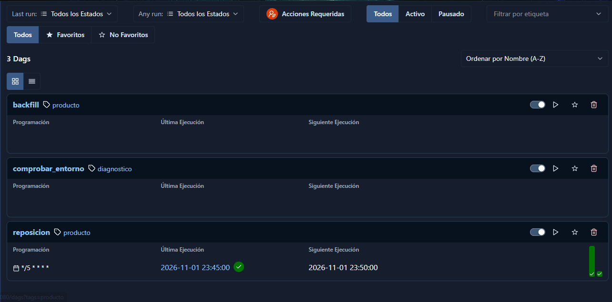
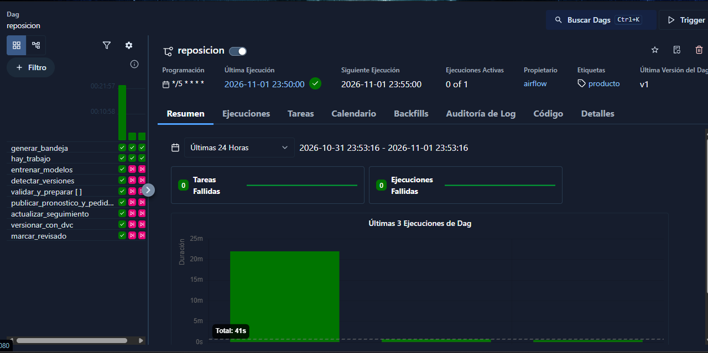
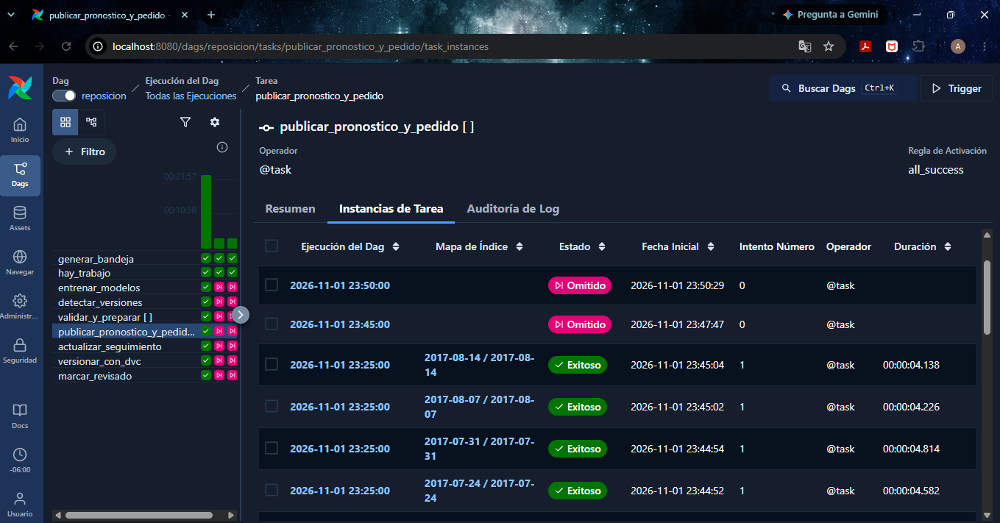

# Motor de Reposición de Inventario

Producto de ML que transforma las ventas diarias de Corporación Favorita en un pedido sugerido por tienda y familia de producto, con Git, DVC y Apache Airflow.

## Levantar el producto

Necesitas Docker o Podman, con al menos 4 GB de memoria disponibles.

1. Descarga los datos de [Kaggle](https://www.kaggle.com/competitions/store-sales-time-series-forecasting/data) y coloca en `data/kaggle/` estos archivos: `train.csv`, `stores.csv`, `holidays_events.csv`, `oil.csv` y `transactions.csv`.
2. Levanta Airflow. La primera vez se construye la imagen, lo que tarda varios minutos.

   ```
   docker compose up -d
   ```

   Con Podman, el comando es `podman compose up -d`. El archivo es el mismo y no necesita cambios.

No hace falta nada más. En un máximo de 5 minutos, el DAG `reposicion` arranca solo, genera la bandeja y procesa todos los cortes. Con los datos completos de Kaggle tarda unos 22 minutos en una laptop y produce 20 cortes, del 2017-04-03 al 2017-08-14.

La interfaz queda en <http://localhost:8080>, con el usuario `airflow` y la contraseña `airflow`.

Para usar otras credenciales, define `AIRFLOW_USER` y `AIRFLOW_PASSWORD` en el entorno o en un archivo `.env` antes de levantar Airflow por primera vez. Solo se aplican al crear la base de datos; para cambiarlas después, usa `docker compose down -v`, que borra el historial de ejecuciones.

## Qué produce

| Carpeta | Contenido |
|---|---|
| `data/historico/` | Lo que ya había llegado el 2017-03-31 |
| `data/bandeja/<fuente>/` | Un archivo por fecha y fuente, tratado como sistema externo |
| `data/procesados/<corte>/<conocimiento>/` | Datos preparados para el modelo |
| `data/modelos/<fecha>/` | La decisión de cada entrenamiento y, si hubo reemplazo, el modelo |
| `data/publicados/<corte>/<conocimiento>/` | `pronostico.csv`, `pedido.csv` y `metadatos.json`; nunca se reescriben |
| `data/seguimiento/` | `reporte.md`, `desempeno.csv` y `comparacion_modelos.csv`: lo publicado frente a las ventas reales y al baseline |
| `data/reportes/ingesta/` | Archivos en cuarentena y avisos de cada fecha |

En `data/publicados/`, `<corte>` es el lunes de emisión y `<conocimiento>` es la fecha de lo que se conocía al calcular. La publicación original tiene ambas iguales. El flujo versiona todo con DVC en cada revisión.

## Cómo inyectar datos

El revisor comprueba la bandeja cada 5 minutos, así que basta con entregar los archivos. La bandeja acepta datos nuevos de dos formas. Las fechas de llegada de cada fuente están en `config/fuentes.yaml`.

### CSV con formato de Kaggle

Agrega las filas nuevas a los CSV de `data/kaggle/`, o reemplázalos por otros con los mismos nombres y columnas. No hace falta incluir las cinco fuentes.

El flujo divide cada CSV por fecha y calcula su entrega según la configuración. Se detiene sin escribir nada si faltan columnas, si una fecha es inválida o si un dato ya entregado llega con otro contenido. El motivo queda en `data/reportes/generacion.json`, y el flujo continúa con lo ya entregado.

### Archivos sueltos

Copia el archivo directamente en la bandeja, con este nombre y las columnas de esa fuente:

```
data/bandeja/<fuente>/<fecha_dato>__<fecha_entrega>.csv
```

Las fechas usan el formato `AAAA-MM-DD`, y un archivo cuyo nombre no siga esta convención no se usa.

### Correcciones

Una corrección se inyecta como archivo suelto, con la misma fecha del dato y una entrega posterior. El archivo anterior se conserva:

```
data/bandeja/train/2017-08-15__2017-08-16.csv   dato original
data/bandeja/train/2017-08-15__2017-08-20.csv   corrección: rige desde el 20
```

La corrección puede traer el archivo completo o solo las filas corregidas: cada fila reemplaza a la anterior con la misma clave y las demás se conservan. Una corrección no puede eliminar una fila.

Cada corte que usaba ese dato recibe una versión nueva en `data/publicados/<corte>/<fecha_entrega>/`. La publicación original no cambia.

## Qué pasa con los datos inválidos

- **Datos inválidos:** el archivo completo queda en cuarentena. Se registra en el reporte y en los metadatos de la publicación con su motivo, no se usa y el proceso continúa.
- **Avisos:** el dato se conserva y queda registrado en el reporte.
- **Carga histórica faltante o inválida:** la tarea falla, porque no hay base con la cual operar.

La lista completa de reglas está en `DECISIONES.md` (D-007).

## Backfill

El DAG `backfill` se dispara a mano desde la interfaz, con los parámetros `desde`, `hasta` y, opcionalmente, `conocimiento`. Un corte sin publicar se emite como original; uno ya publicado se reprocesa como una versión nueva.

## Reproducir un pronóstico publicado

Este comando recalcula una publicación desde los datos y la compara byte a byte:

```
docker compose exec airflow-scheduler python -m inventario.publicacion --corte 2017-04-03 --raiz /opt/inventario
```

Agrega `--conocimiento <fecha>` para reproducir una versión posterior a la original.

## Evidencia de funcionamiento

Corrida completa con los datos de Kaggle, en una laptop con Podman, sin disparar nada a mano: 5 entrenamientos y 20 cortes en unos 22 minutos.

### Ejecuciones en Airflow



La ejecución de 22 minutos procesó todo. Las siguientes aparecen como omitidas porque no llegó nada nuevo.



Cada corte se publica como una instancia identificada por corte y conocimiento.



### Comparación de modelos

Resultado en el periodo de seguimiento, con 19 cortes de semana completa que no se usaron para elegir el modelo:

| Métrica | Publicado | Baseline con los mismos datos | Cortes donde gana lo publicado |
|---|---|---|---|
| WAPE del cuantil 0.50 | 0.140 | 0.150 | 12 de 19 |
| Cobertura del intervalo 0.10 a 0.90 (ideal 80%) | 76.9% | 70.9% | 19 de 19 |
| Costo de negocio | 17,046,687 (-2.0%) | 17,401,970 | 9 de 19 |

El modelo mejora con claridad la precisión y la cobertura. **La mejora en costo no es concluyente:** sin el corte del 2017-05-29, el modelo cuesta 0.2% más. Los costos son además supuestos del producto (`DECISIONES.md`, D-023).

- **Por corte y decisiones de modelo:** [`docs/evidencia/reporte-seguimiento.md`](docs/evidencia/reporte-seguimiento.md)
- **Comparación en cada entrenamiento:** [`docs/evidencia/comparacion-modelos.csv`](docs/evidencia/comparacion-modelos.csv)

### Reproducción de un pronóstico pasado con DVC

Desde un clon limpio. El remoto es una carpeta que no va en Git, así que hay que colocarla junto al clon. Los comandos usan Podman; con Docker son equivalentes.

```
git clone https://github.com/AudrickVeliz/lab1-inventario.git
cd lab1-inventario
cp -r <proyecto-original>/dvc-remote dvc-remote
dvc pull data/historico.dvc data/bandeja.dvc data/modelos.dvc data/publicados.dvc
podman run --rm --entrypoint python -e PYTHONPATH=/opt/rep/src -v .:/opt/rep \
  inventario-airflow:3.3.2 -m inventario.publicacion --corte 2017-06-05 --raiz /opt/rep
```

Resultados obtenidos:

```
500 files fetched and 496 files added
publicaciones 20 | modelos 5

modelo: idéntico pronostico.csv: idéntico pedido.csv: idéntico  <- 2017-04-03
modelo: idéntico pronostico.csv: idéntico pedido.csv: idéntico  <- 2017-06-05
modelo: idéntico pronostico.csv: idéntico pedido.csv: idéntico  <- 2017-08-07
```

Fuera del contenedor, `pedido.csv` también es idéntico. En Windows, `pronostico.csv` difiere hasta en 5e-12 por el redondeo de punto flotante, por lo que la comparación byte a byte requiere el mismo entorno.

## Desarrollo

Para ejecutar las pruebas, usa Python 3.12:

```
pip install -e ".[dev]"
python -m pytest
```

El DAG `comprobar_entorno` se dispara a mano y comprueba la instalación de punta a punta.
